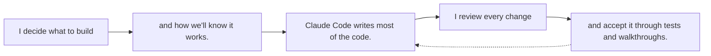
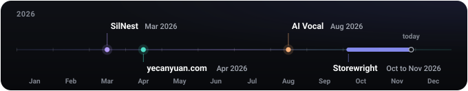
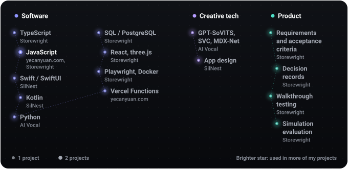
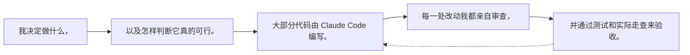

<!-- Generated by scripts/make_readme.py from data/profile.json. Edit those, then run it again. -->
<p><a href="https://glacieerr.github.io/"><picture>
  <source media="(max-width: 600px) and (prefers-color-scheme: light)" srcset="https://glacieerr-lockscreen.vercel.app/api/lockscreen?theme=light&layout=portrait&weight=bold">
  <source media="(max-width: 600px)" srcset="https://glacieerr-lockscreen.vercel.app/api/lockscreen?theme=dark&layout=portrait&weight=bold">
  <source media="(prefers-color-scheme: light)" srcset="https://glacieerr-lockscreen.vercel.app/api/lockscreen?theme=light&layout=below&weight=bold">
  
</picture></a></p>

<p>
<a href="https://github.com/Glacieerr/storewright"><picture><source media="(prefers-color-scheme: light)" srcset="https://raw.githubusercontent.com/Glacieerr/Glacieerr/output/milestone-1-light.svg"></picture></a>
<a href="https://apps.apple.com/app/id6796483224"><picture><source media="(prefers-color-scheme: light)" srcset="https://raw.githubusercontent.com/Glacieerr/Glacieerr/output/milestone-2-light.svg"></picture></a>
</p>

<table><tr>
<td><a href="https://apps.apple.com/app/id6796483224"><picture><source media="(prefers-color-scheme: light)" srcset="https://raw.githubusercontent.com/Glacieerr/Glacieerr/output/w-silnest-light.svg"></picture></a><br><a href="https://apps.apple.com/app/id6796483224">App&nbsp;Store&nbsp;↗</a>&nbsp;&nbsp;&nbsp;&nbsp;&nbsp;&nbsp;&nbsp;&nbsp;&nbsp;&nbsp;&nbsp;&nbsp;&nbsp;&nbsp;&nbsp;&nbsp;&nbsp;&nbsp;&nbsp;&nbsp;&nbsp;&nbsp;&nbsp;&nbsp;&nbsp;&nbsp;&nbsp;&nbsp;&nbsp;&nbsp;&nbsp;&nbsp;&nbsp;&nbsp;&nbsp;&nbsp;&nbsp;&nbsp;&nbsp;&nbsp;&nbsp;&nbsp;&nbsp;&nbsp;&nbsp;&nbsp;&nbsp;&nbsp;&nbsp;&nbsp;&nbsp;&nbsp;&nbsp;&nbsp;&nbsp;&nbsp;&nbsp;&nbsp;&nbsp;&nbsp;&nbsp;&nbsp;&nbsp;&nbsp;&nbsp;&nbsp;&nbsp;&nbsp;</td>
<td><a href="https://glacieerr.github.io/storewright"><picture><source media="(prefers-color-scheme: light)" srcset="https://raw.githubusercontent.com/Glacieerr/Glacieerr/output/w-storewright-light.svg"></picture></a><br><a href="https://glacieerr.github.io/storewright">Live&nbsp;demo&nbsp;↗</a>&nbsp;&nbsp;&nbsp;&nbsp;&nbsp;&nbsp;&nbsp;&nbsp;&nbsp;&nbsp;&nbsp;&nbsp;&nbsp;&nbsp;&nbsp;&nbsp;&nbsp;&nbsp;&nbsp;&nbsp;&nbsp;&nbsp;&nbsp;&nbsp;&nbsp;&nbsp;&nbsp;&nbsp;&nbsp;&nbsp;&nbsp;&nbsp;&nbsp;&nbsp;&nbsp;&nbsp;&nbsp;&nbsp;&nbsp;&nbsp;&nbsp;&nbsp;&nbsp;&nbsp;&nbsp;&nbsp;&nbsp;&nbsp;&nbsp;&nbsp;&nbsp;&nbsp;&nbsp;&nbsp;&nbsp;&nbsp;&nbsp;&nbsp;&nbsp;&nbsp;&nbsp;&nbsp;&nbsp;&nbsp;&nbsp;&nbsp;&nbsp;</td>
<td><a href="https://github.com/Glacieerr/storewright"><picture><source media="(prefers-color-scheme: light)" srcset="https://raw.githubusercontent.com/Glacieerr/Glacieerr/output/w-store-day-light.svg"></picture></a><br><a href="https://github.com/Glacieerr/storewright">Simulator&nbsp;↗</a>&nbsp;&nbsp;&nbsp;&nbsp;&nbsp;&nbsp;&nbsp;&nbsp;&nbsp;&nbsp;&nbsp;&nbsp;&nbsp;&nbsp;&nbsp;&nbsp;&nbsp;&nbsp;&nbsp;&nbsp;&nbsp;&nbsp;&nbsp;</td>
<td><a href="https://github.com/Glacieerr/storewright"><picture><source media="(prefers-color-scheme: light)" srcset="https://raw.githubusercontent.com/Glacieerr/Glacieerr/output/w-accuracy-light.svg"></picture></a><br><a href="https://github.com/Glacieerr/storewright">The&nbsp;eval&nbsp;↗</a>&nbsp;&nbsp;&nbsp;&nbsp;&nbsp;&nbsp;&nbsp;&nbsp;&nbsp;&nbsp;&nbsp;&nbsp;&nbsp;&nbsp;&nbsp;&nbsp;&nbsp;&nbsp;&nbsp;&nbsp;&nbsp;&nbsp;&nbsp;&nbsp;&nbsp;</td>
<td><a href="https://yecanyuan.com"><picture><source media="(prefers-color-scheme: light)" srcset="https://raw.githubusercontent.com/Glacieerr/Glacieerr/output/w-site-light.svg"></picture></a><br><a href="https://yecanyuan.com">yecanyuan.com&nbsp;↗</a>&nbsp;&nbsp;&nbsp;&nbsp;&nbsp;&nbsp;&nbsp;&nbsp;&nbsp;&nbsp;&nbsp;&nbsp;&nbsp;&nbsp;&nbsp;&nbsp;&nbsp;&nbsp;&nbsp;&nbsp;&nbsp;&nbsp;&nbsp;&nbsp;&nbsp;&nbsp;&nbsp;&nbsp;&nbsp;&nbsp;&nbsp;&nbsp;&nbsp;&nbsp;&nbsp;&nbsp;&nbsp;&nbsp;&nbsp;&nbsp;&nbsp;&nbsp;&nbsp;&nbsp;&nbsp;&nbsp;&nbsp;&nbsp;&nbsp;&nbsp;&nbsp;&nbsp;&nbsp;&nbsp;&nbsp;&nbsp;&nbsp;&nbsp;</td>
<td><picture><source media="(prefers-color-scheme: light)" srcset="https://raw.githubusercontent.com/Glacieerr/Glacieerr/output/w-vocal-light.svg"></picture><br>Personal&nbsp;project&nbsp;&nbsp;&nbsp;&nbsp;&nbsp;&nbsp;&nbsp;&nbsp;&nbsp;&nbsp;&nbsp;&nbsp;&nbsp;&nbsp;&nbsp;</td>
<td><a href="https://glacieerr.github.io/#sky"><picture><source media="(prefers-color-scheme: light)" srcset="https://raw.githubusercontent.com/Glacieerr/Glacieerr/output/w-sky-light.svg"></picture></a><br><a href="https://glacieerr.github.io/#sky">Your&nbsp;city's&nbsp;sky&nbsp;↗</a>&nbsp;&nbsp;&nbsp;&nbsp;&nbsp;&nbsp;&nbsp;&nbsp;&nbsp;&nbsp;&nbsp;&nbsp;&nbsp;&nbsp;&nbsp;&nbsp;&nbsp;&nbsp;&nbsp;&nbsp;&nbsp;&nbsp;&nbsp;&nbsp;&nbsp;&nbsp;&nbsp;&nbsp;&nbsp;&nbsp;&nbsp;&nbsp;&nbsp;&nbsp;&nbsp;&nbsp;&nbsp;&nbsp;&nbsp;&nbsp;&nbsp;&nbsp;&nbsp;&nbsp;&nbsp;&nbsp;&nbsp;&nbsp;&nbsp;&nbsp;&nbsp;&nbsp;&nbsp;&nbsp;&nbsp;&nbsp;&nbsp;&nbsp;&nbsp;&nbsp;</td>
<td><a href="https://www.linkedin.com/in/canyuanye"><picture><source media="(prefers-color-scheme: light)" srcset="https://raw.githubusercontent.com/Glacieerr/Glacieerr/output/w-contact-light.svg"></picture></a><br><a href="https://www.linkedin.com/in/canyuanye">LinkedIn&nbsp;↗</a>&nbsp;&nbsp;&nbsp;&nbsp;&nbsp;&nbsp;&nbsp;&nbsp;&nbsp;&nbsp;&nbsp;&nbsp;&nbsp;&nbsp;&nbsp;&nbsp;&nbsp;&nbsp;&nbsp;&nbsp;&nbsp;&nbsp;&nbsp;&nbsp;&nbsp;</td>
</tr></table>

<sub>Scroll sideways for more widgets. The clock is my local time in Albany, NY; the dot around my avatar ticks the seconds, and the planets set off from where they really are today.</sub>

Hi, I'm Canyuan. I build software, creative tech and products: AI-native, and proven by tests.

<p><picture><source media="(prefers-color-scheme: light)" srcset="https://raw.githubusercontent.com/Glacieerr/Glacieerr/output/divider-light.svg"></picture></p>

### Storewright in 90 seconds

https://github.com/user-attachments/assets/949ca7df-c610-4c8d-856e-73e4058623bb

A grocery store digital twin that runs in your browser. **[Open the live demo ↗](https://glacieerr.github.io/storewright/)** · [Read the README](https://github.com/Glacieerr/storewright#readme)

<p><picture><source media="(prefers-color-scheme: light)" srcset="https://raw.githubusercontent.com/Glacieerr/Glacieerr/output/divider-light.svg"></picture></p>

### <a name="how-i-work"></a>How I work

I decide what to build and how we'll know it works. Claude Code writes most of the code; I review every change and accept it through tests and walkthroughs.



[](https://github.com/Glacieerr/storewright/actions/workflows/ci.yml) <sub>Storewright's 800+ tests run on every change.</sub>

<p><picture><source media="(prefers-color-scheme: light)" srcset="https://raw.githubusercontent.com/Glacieerr/Glacieerr/output/divider-light.svg"></picture></p>

### Now

- **AI Vocal**: a local voice and singing studio for my own content (GPT-SoVITS, SVC)

<picture><source media="(prefers-color-scheme: light)" srcset="https://raw.githubusercontent.com/Glacieerr/Glacieerr/output/timeline-light.svg"></picture>

<p><picture><source media="(prefers-color-scheme: light)" srcset="https://raw.githubusercontent.com/Glacieerr/Glacieerr/output/divider-light.svg"></picture></p>

### Skills

<picture><source media="(prefers-color-scheme: light)" srcset="https://raw.githubusercontent.com/Glacieerr/Glacieerr/output/skills-light.svg"></picture>

<sub>The brighter a star, the more of my projects used it. The same map as a list is in the unlocked part below.</sub>

<details>
<summary><a name="unlock"><picture><source media="(prefers-color-scheme: light)" srcset="https://raw.githubusercontent.com/Glacieerr/Glacieerr/output/unlock-light.svg"></picture></a></summary>

<p>
<a href="https://apps.apple.com/app/id6796483224"><picture><source media="(prefers-color-scheme: light)" srcset="https://raw.githubusercontent.com/Glacieerr/Glacieerr/output/icon-silnest-light.svg"></picture></a>
<a href="https://github.com/Glacieerr/storewright"><picture><source media="(prefers-color-scheme: light)" srcset="https://raw.githubusercontent.com/Glacieerr/Glacieerr/output/icon-storewright-light.svg"></picture></a>
<a href="https://yecanyuan.com"><picture><source media="(prefers-color-scheme: light)" srcset="https://raw.githubusercontent.com/Glacieerr/Glacieerr/output/icon-site-light.svg"></picture></a>
<picture><source media="(prefers-color-scheme: light)" srcset="https://raw.githubusercontent.com/Glacieerr/Glacieerr/output/icon-vocal-light.svg"></picture>
<a href="#how-i-work"><picture><source media="(prefers-color-scheme: light)" srcset="https://raw.githubusercontent.com/Glacieerr/Glacieerr/output/icon-howiwork-light.svg"></picture></a>
<a href="https://github.com/Glacieerr?tab=repositories"><picture><source media="(prefers-color-scheme: light)" srcset="https://raw.githubusercontent.com/Glacieerr/Glacieerr/output/icon-earlywork-light.svg"></picture></a>
<a href="https://www.linkedin.com/in/canyuanye"><picture><source media="(prefers-color-scheme: light)" srcset="https://raw.githubusercontent.com/Glacieerr/Glacieerr/output/icon-contact-light.svg"></picture></a>
</p>

#### 中文介绍

我是叶璨源，一个通才型开发者：用 Claude、ChatGPT 等多种 AI 工具，把想法做成能用、能测的成品。代表作是已经上架 App Store 的离线音乐播放器声藏 · SilNest，以及在浏览器里运行的杂货门店数字孪生 Storewright。

**我的工作方式**



**可以问我：**[离线优先的手机 App](https://apps.apple.com/app/id6796483224) · [门店仿真](https://github.com/Glacieerr/storewright) · [用 AI 工具把想法做成能测的成品](#how-i-work) · [本地 AI 声音创作](https://glacieerr.github.io/#home/vocal)

#### The skill map as a list

- **Software:** TypeScript (Storewright) · JavaScript (yecanyuan.com, Storewright) · Swift / SwiftUI (SilNest) · Kotlin (SilNest) · Python (AI Vocal) · SQL / PostgreSQL (Storewright) · React, three.js (Storewright) · Playwright, Docker (Storewright) · Vercel Functions (yecanyuan.com)
- **Creative tech:** GPT-SoVITS, SVC, MDX-Net (AI Vocal) · App design (SilNest)
- **Product:** Requirements and acceptance criteria (Storewright) · Decision records (Storewright) · Walkthrough testing (Storewright) · Simulation evaluation (Storewright)

#### Rotate my store

Storewright's medium store, exported from its own layout code. Drag to turn it.

```stl
solid storewright_medium_store
facet normal 0 0 -1
outer loop
vertex 0 0 -0.2
vertex 0 38.6 -0.2
vertex 82.2 38.6 -0.2
endloop
endfacet
facet normal 0 0 -1
outer loop
vertex 0 0 -0.2
vertex 82.2 38.6 -0.2
vertex 82.2 0 -0.2
endloop
endfacet
facet normal 0 0 1
outer loop
vertex 0 0 0
vertex 82.2 0 0
vertex 82.2 38.6 0
endloop
endfacet
facet normal 0 0 1
outer loop
vertex 0 0 0
vertex 82.2 38.6 0
vertex 0 38.6 0
endloop
endfacet
facet normal 0 -1 0
outer loop
vertex 0 0 -0.2
vertex 82.2 0 -0.2
vertex 82.2 0 0
endloop
endfacet
facet normal 0 -1 0
outer loop
vertex 0 0 -0.2
vertex 82.2 0 0
vertex 0 0 0
endloop
endfacet
facet normal 0 1 0
outer loop
vertex 0 38.6 -0.2
vertex 0 38.6 0
vertex 82.2 38.6 0
endloop
endfacet
facet normal 0 1 0
outer loop
vertex 0 38.6 -0.2
vertex 82.2 38.6 0
vertex 82.2 38.6 -0.2
endloop
endfacet
facet normal -1 0 0
outer loop
vertex 0 0 -0.2
vertex 0 0 0
vertex 0 38.6 0
endloop
endfacet
facet normal -1 0 0
outer loop
vertex 0 0 -0.2
vertex 0 38.6 0
vertex 0 38.6 -0.2
endloop
endfacet
facet normal 1 0 0
outer loop
vertex 82.2 0 -0.2
vertex 82.2 38.6 -0.2
vertex 82.2 38.6 0
endloop
endfacet
facet normal 1 0 0
outer loop
vertex 82.2 0 -0.2
vertex 82.2 38.6 0
vertex 82.2 0 0
endloop
endfacet
facet normal 0 0 -1
outer loop
vertex 2.5 7.52 0
vertex 2.5 27 0
vertex 3.4 27 0
endloop
endfacet
facet normal 0 0 -1
outer loop
vertex 2.5 7.52 0
vertex 3.4 27 0
vertex 3.4 7.52 0
endloop
endfacet
facet normal 0 0 1
outer loop
vertex 2.5 7.52 1.27
vertex 3.4 7.52 1.27
vertex 3.4 27 1.27
endloop
endfacet
facet normal 0 0 1
outer loop
vertex 2.5 7.52 1.27
vertex 3.4 27 1.27
vertex 2.5 27 1.27
endloop
endfacet
facet normal 0 -1 0
outer loop
vertex 2.5 7.52 0
vertex 3.4 7.52 0
vertex 3.4 7.52 1.27
endloop
endfacet
facet normal 0 -1 0
outer loop
vertex 2.5 7.52 0
vertex 3.4 7.52 1.27
vertex 2.5 7.52 1.27
endloop
endfacet
facet normal 0 1 0
outer loop
vertex 2.5 27 0
vertex 2.5 27 1.27
vertex 3.4 27 1.27
endloop
endfacet
facet normal 0 1 0
outer loop
vertex 2.5 27 0
vertex 3.4 27 1.27
vertex 3.4 27 0
endloop
endfacet
facet normal -1 0 0
outer loop
vertex 2.5 7.52 0
vertex 2.5 7.52 1.27
vertex 2.5 27 1.27
endloop
endfacet
facet normal -1 0 0
outer loop
vertex 2.5 7.52 0
vertex 2.5 27 1.27
vertex 2.5 27 0
endloop
endfacet
facet normal 1 0 0
outer loop
vertex 3.4 7.52 0
vertex 3.4 27 0
vertex 3.4 27 1.27
endloop
endfacet
facet normal 1 0 0
outer loop
vertex 3.4 7.52 0
vertex 3.4 27 1.27
vertex 3.4 7.52 1.27
endloop
endfacet
facet normal 0 0 -1
outer loop
vertex 5.52 29.12 0
vertex 5.52 30.02 0
vertex 30.48 30.02 0
endloop
endfacet
facet normal 0 0 -1
outer loop
vertex 5.52 29.12 0
vertex 30.48 30.02 0
vertex 30.48 29.12 0
endloop
endfacet
facet normal 0 0 1
outer loop
vertex 5.52 29.12 1.27
vertex 30.48 29.12 1.27
vertex 30.48 30.02 1.27
endloop
endfacet
facet normal 0 0 1
outer loop
vertex 5.52 29.12 1.27
vertex 30.48 30.02 1.27
vertex 5.52 30.02 1.27
endloop
endfacet
facet normal 0 -1 0
outer loop
vertex 5.52 29.12 0
vertex 30.48 29.12 0
vertex 30.48 29.12 1.27
endloop
endfacet
facet normal 0 -1 0
outer loop
vertex 5.52 29.12 0
vertex 30.48 29.12 1.27
vertex 5.52 29.12 1.27
endloop
endfacet
facet normal 0 1 0
outer loop
vertex 5.52 30.02 0
vertex 5.52 30.02 1.27
vertex 30.48 30.02 1.27
endloop
endfacet
facet normal 0 1 0
outer loop
vertex 5.52 30.02 0
vertex 30.48 30.02 1.27
vertex 30.48 30.02 0
endloop
endfacet
facet normal -1 0 0
outer loop
vertex 5.52 29.12 0
vertex 5.52 29.12 1.27
vertex 5.52 30.02 1.27
endloop
endfacet
facet normal -1 0 0
outer loop
vertex 5.52 29.12 0
vertex 5.52 30.02 1.27
vertex 5.52 30.02 0
endloop
endfacet
facet normal 1 0 0
outer loop
vertex 30.48 29.12 0
vertex 30.48 30.02 0
vertex 30.48 30.02 1.27
endloop
endfacet
facet normal 1 0 0
outer loop
vertex 30.48 29.12 0
vertex 30.48 30.02 1.27
vertex 30.48 29.12 1.27
endloop
endfacet
facet normal 0 0 -1
outer loop
vertex 6.5 7.52 0
vertex 6.5 27 0
vertex 7.4 27 0
endloop
endfacet
facet normal 0 0 -1
outer loop
vertex 6.5 7.52 0
vertex 7.4 27 0
vertex 7.4 7.52 0
endloop
endfacet
facet normal 0 0 1
outer loop
vertex 6.5 7.52 1.95
vertex 7.4 7.52 1.95
vertex 7.4 27 1.95
endloop
endfacet
facet normal 0 0 1
outer loop
vertex 6.5 7.52 1.95
vertex 7.4 27 1.95
vertex 6.5 27 1.95
endloop
endfacet
facet normal 0 -1 0
outer loop
vertex 6.5 7.52 0
vertex 7.4 7.52 0
vertex 7.4 7.52 1.95
endloop
endfacet
facet normal 0 -1 0
outer loop
vertex 6.5 7.52 0
vertex 7.4 7.52 1.95
vertex 6.5 7.52 1.95
endloop
endfacet
facet normal 0 1 0
outer loop
vertex 6.5 27 0
vertex 6.5 27 1.95
vertex 7.4 27 1.95
endloop
endfacet
facet normal 0 1 0
outer loop
vertex 6.5 27 0
vertex 7.4 27 1.95
vertex 7.4 27 0
endloop
endfacet
facet normal -1 0 0
outer loop
vertex 6.5 7.52 0
vertex 6.5 7.52 1.95
vertex 6.5 27 1.95
endloop
endfacet
facet normal -1 0 0
outer loop
vertex 6.5 7.52 0
vertex 6.5 27 1.95
vertex 6.5 27 0
endloop
endfacet
facet normal 1 0 0
outer loop
vertex 7.4 7.52 0
vertex 7.4 27 0
vertex 7.4 27 1.95
endloop
endfacet
facet normal 1 0 0
outer loop
vertex 7.4 7.52 0
vertex 7.4 27 1.95
vertex 7.4 7.52 1.95
endloop
endfacet
facet normal 0 0 -1
outer loop
vertex 8.6 7.52 0
vertex 8.6 27 0
vertex 10.6 27 0
endloop
endfacet
facet normal 0 0 -1
outer loop
vertex 8.6 7.52 0
vertex 10.6 27 0
vertex 10.6 7.52 0
endloop
endfacet
facet normal 0 0 1
outer loop
vertex 8.6 7.52 1.95
vertex 10.6 7.52 1.95
vertex 10.6 27 1.95
endloop
endfacet
facet normal 0 0 1
outer loop
vertex 8.6 7.52 1.95
vertex 10.6 27 1.95
vertex 8.6 27 1.95
endloop
endfacet
facet normal 0 -1 0
outer loop
vertex 8.6 7.52 0
vertex 10.6 7.52 0
vertex 10.6 7.52 1.95
endloop
endfacet
facet normal 0 -1 0
outer loop
vertex 8.6 7.52 0
vertex 10.6 7.52 1.95
vertex 8.6 7.52 1.95
endloop
endfacet
facet normal 0 1 0
outer loop
vertex 8.6 27 0
vertex 8.6 27 1.95
vertex 10.6 27 1.95
endloop
endfacet
facet normal 0 1 0
outer loop
vertex 8.6 27 0
vertex 10.6 27 1.95
vertex 10.6 27 0
endloop
endfacet
facet normal -1 0 0
outer loop
vertex 8.6 7.52 0
vertex 8.6 7.52 1.95
vertex 8.6 27 1.95
endloop
endfacet
facet normal -1 0 0
outer loop
vertex 8.6 7.52 0
vertex 8.6 27 1.95
vertex 8.6 27 0
endloop
endfacet
facet normal 1 0 0
outer loop
vertex 10.6 7.52 0
vertex 10.6 27 0
vertex 10.6 27 1.95
endloop
endfacet
facet normal 1 0 0
outer loop
vertex 10.6 7.52 0
vertex 10.6 27 1.95
vertex 10.6 7.52 1.95
endloop
endfacet
facet normal 0 0 -1
outer loop
vertex 11.8 7.52 0
vertex 11.8 27 0
vertex 13.8 27 0
endloop
endfacet
facet normal 0 0 -1
outer loop
vertex 11.8 7.52 0
vertex 13.8 27 0
vertex 13.8 7.52 0
endloop
endfacet
facet normal 0 0 1
outer loop
vertex 11.8 7.52 1.95
vertex 13.8 7.52 1.95
vertex 13.8 27 1.95
endloop
endfacet
facet normal 0 0 1
outer loop
vertex 11.8 7.52 1.95
vertex 13.8 27 1.95
vertex 11.8 27 1.95
endloop
endfacet
facet normal 0 -1 0
outer loop
vertex 11.8 7.52 0
vertex 13.8 7.52 0
vertex 13.8 7.52 1.95
endloop
endfacet
facet normal 0 -1 0
outer loop
vertex 11.8 7.52 0
vertex 13.8 7.52 1.95
vertex 11.8 7.52 1.95
endloop
endfacet
facet normal 0 1 0
outer loop
vertex 11.8 27 0
vertex 11.8 27 1.95
vertex 13.8 27 1.95
endloop
endfacet
facet normal 0 1 0
outer loop
vertex 11.8 27 0
vertex 13.8 27 1.95
vertex 13.8 27 0
endloop
endfacet
facet normal -1 0 0
outer loop
vertex 11.8 7.52 0
vertex 11.8 7.52 1.95
vertex 11.8 27 1.95
endloop
endfacet
facet normal -1 0 0
outer loop
vertex 11.8 7.52 0
vertex 11.8 27 1.95
vertex 11.8 27 0
endloop
endfacet
facet normal 1 0 0
outer loop
vertex 13.8 7.52 0
vertex 13.8 27 0
vertex 13.8 27 1.95
endloop
endfacet
facet normal 1 0 0
outer loop
vertex 13.8 7.52 0
vertex 13.8 27 1.95
vertex 13.8 7.52 1.95
endloop
endfacet
facet normal 0 0 -1
outer loop
vertex 15 7.52 0
vertex 15 27 0
vertex 17 27 0
endloop
endfacet
facet normal 0 0 -1
outer loop
vertex 15 7.52 0
vertex 17 27 0
vertex 17 7.52 0
endloop
endfacet
facet normal 0 0 1
outer loop
vertex 15 7.52 1.95
vertex 17 7.52 1.95
vertex 17 27 1.95
endloop
endfacet
facet normal 0 0 1
outer loop
vertex 15 7.52 1.95
vertex 17 27 1.95
vertex 15 27 1.95
endloop
endfacet
facet normal 0 -1 0
outer loop
vertex 15 7.52 0
vertex 17 7.52 0
vertex 17 7.52 1.95
endloop
endfacet
facet normal 0 -1 0
outer loop
vertex 15 7.52 0
vertex 17 7.52 1.95
vertex 15 7.52 1.95
endloop
endfacet
facet normal 0 1 0
outer loop
vertex 15 27 0
vertex 15 27 1.95
vertex 17 27 1.95
endloop
endfacet
facet normal 0 1 0
outer loop
vertex 15 27 0
vertex 17 27 1.95
vertex 17 27 0
endloop
endfacet
facet normal -1 0 0
outer loop
vertex 15 7.52 0
vertex 15 7.52 1.95
vertex 15 27 1.95
endloop
endfacet
facet normal -1 0 0
outer loop
vertex 15 7.52 0
vertex 15 27 1.95
vertex 15 27 0
endloop
endfacet
facet normal 1 0 0
outer loop
vertex 17 7.52 0
vertex 17 27 0
vertex 17 27 1.95
endloop
endfacet
facet normal 1 0 0
outer loop
vertex 17 7.52 0
vertex 17 27 1.95
vertex 17 7.52 1.95
endloop
endfacet
facet normal 0 0 -1
outer loop
vertex 18.2 7.52 0
vertex 18.2 27 0
vertex 20.2 27 0
endloop
endfacet
facet normal 0 0 -1
outer loop
vertex 18.2 7.52 0
vertex 20.2 27 0
vertex 20.2 7.52 0
endloop
endfacet
facet normal 0 0 1
outer loop
vertex 18.2 7.52 1.95
vertex 20.2 7.52 1.95
vertex 20.2 27 1.95
endloop
endfacet
facet normal 0 0 1
outer loop
vertex 18.2 7.52 1.95
vertex 20.2 27 1.95
vertex 18.2 27 1.95
endloop
endfacet
facet normal 0 -1 0
outer loop
vertex 18.2 7.52 0
vertex 20.2 7.52 0
vertex 20.2 7.52 1.95
endloop
endfacet
facet normal 0 -1 0
outer loop
vertex 18.2 7.52 0
vertex 20.2 7.52 1.95
vertex 18.2 7.52 1.95
endloop
endfacet
facet normal 0 1 0
outer loop
vertex 18.2 27 0
vertex 18.2 27 1.95
vertex 20.2 27 1.95
endloop
endfacet
facet normal 0 1 0
outer loop
vertex 18.2 27 0
vertex 20.2 27 1.95
vertex 20.2 27 0
endloop
endfacet
facet normal -1 0 0
outer loop
vertex 18.2 7.52 0
vertex 18.2 7.52 1.95
vertex 18.2 27 1.95
endloop
endfacet
facet normal -1 0 0
outer loop
vertex 18.2 7.52 0
vertex 18.2 27 1.95
vertex 18.2 27 0
endloop
endfacet
facet normal 1 0 0
outer loop
vertex 20.2 7.52 0
vertex 20.2 27 0
vertex 20.2 27 1.95
endloop
endfacet
facet normal 1 0 0
outer loop
vertex 20.2 7.52 0
vertex 20.2 27 1.95
vertex 20.2 7.52 1.95
endloop
endfacet
facet normal 0 0 -1
outer loop
vertex 21.4 7.52 0
vertex 21.4 27 0
vertex 23.4 27 0
endloop
endfacet
facet normal 0 0 -1
outer loop
vertex 21.4 7.52 0
vertex 23.4 27 0
vertex 23.4 7.52 0
endloop
endfacet
facet normal 0 0 1
outer loop
vertex 21.4 7.52 1.95
vertex 23.4 7.52 1.95
vertex 23.4 27 1.95
endloop
endfacet
facet normal 0 0 1
outer loop
vertex 21.4 7.52 1.95
vertex 23.4 27 1.95
vertex 21.4 27 1.95
endloop
endfacet
facet normal 0 -1 0
outer loop
vertex 21.4 7.52 0
vertex 23.4 7.52 0
vertex 23.4 7.52 1.95
endloop
endfacet
facet normal 0 -1 0
outer loop
vertex 21.4 7.52 0
vertex 23.4 7.52 1.95
vertex 21.4 7.52 1.95
endloop
endfacet
facet normal 0 1 0
outer loop
vertex 21.4 27 0
vertex 21.4 27 1.95
vertex 23.4 27 1.95
endloop
endfacet
facet normal 0 1 0
outer loop
vertex 21.4 27 0
vertex 23.4 27 1.95
vertex 23.4 27 0
endloop
endfacet
facet normal -1 0 0
outer loop
vertex 21.4 7.52 0
vertex 21.4 7.52 1.95
vertex 21.4 27 1.95
endloop
endfacet
facet normal -1 0 0
outer loop
vertex 21.4 7.52 0
vertex 21.4 27 1.95
vertex 21.4 27 0
endloop
endfacet
facet normal 1 0 0
outer loop
vertex 23.4 7.52 0
vertex 23.4 27 0
vertex 23.4 27 1.95
endloop
endfacet
facet normal 1 0 0
outer loop
vertex 23.4 7.52 0
vertex 23.4 27 1.95
vertex 23.4 7.52 1.95
endloop
endfacet
facet normal 0 0 -1
outer loop
vertex 24.6 7.52 0
vertex 24.6 27 0
vertex 26.6 27 0
endloop
endfacet
facet normal 0 0 -1
outer loop
vertex 24.6 7.52 0
vertex 26.6 27 0
vertex 26.6 7.52 0
endloop
endfacet
facet normal 0 0 1
outer loop
vertex 24.6 7.52 1.95
vertex 26.6 7.52 1.95
vertex 26.6 27 1.95
endloop
endfacet
facet normal 0 0 1
outer loop
vertex 24.6 7.52 1.95
vertex 26.6 27 1.95
vertex 24.6 27 1.95
endloop
endfacet
facet normal 0 -1 0
outer loop
vertex 24.6 7.52 0
vertex 26.6 7.52 0
vertex 26.6 7.52 1.95
endloop
endfacet
facet normal 0 -1 0
outer loop
vertex 24.6 7.52 0
vertex 26.6 7.52 1.95
vertex 24.6 7.52 1.95
endloop
endfacet
facet normal 0 1 0
outer loop
vertex 24.6 27 0
vertex 24.6 27 1.95
vertex 26.6 27 1.95
endloop
endfacet
facet normal 0 1 0
outer loop
vertex 24.6 27 0
vertex 26.6 27 1.95
vertex 26.6 27 0
endloop
endfacet
facet normal -1 0 0
outer loop
vertex 24.6 7.52 0
vertex 24.6 7.52 1.95
vertex 24.6 27 1.95
endloop
endfacet
facet normal -1 0 0
outer loop
vertex 24.6 7.52 0
vertex 24.6 27 1.95
vertex 24.6 27 0
endloop
endfacet
facet normal 1 0 0
outer loop
vertex 26.6 7.52 0
vertex 26.6 27 0
vertex 26.6 27 1.95
endloop
endfacet
facet normal 1 0 0
outer loop
vertex 26.6 7.52 0
vertex 26.6 27 1.95
vertex 26.6 7.52 1.95
endloop
endfacet
facet normal 0 0 -1
outer loop
vertex 27.8 7.52 0
vertex 27.8 27 0
vertex 29.8 27 0
endloop
endfacet
facet normal 0 0 -1
outer loop
vertex 27.8 7.52 0
vertex 29.8 27 0
vertex 29.8 7.52 0
endloop
endfacet
facet normal 0 0 1
outer loop
vertex 27.8 7.52 1.95
vertex 29.8 7.52 1.95
vertex 29.8 27 1.95
endloop
endfacet
facet normal 0 0 1
outer loop
vertex 27.8 7.52 1.95
vertex 29.8 27 1.95
vertex 27.8 27 1.95
endloop
endfacet
facet normal 0 -1 0
outer loop
vertex 27.8 7.52 0
vertex 29.8 7.52 0
vertex 29.8 7.52 1.95
endloop
endfacet
facet normal 0 -1 0
outer loop
vertex 27.8 7.52 0
vertex 29.8 7.52 1.95
vertex 27.8 7.52 1.95
endloop
endfacet
facet normal 0 1 0
outer loop
vertex 27.8 27 0
vertex 27.8 27 1.95
vertex 29.8 27 1.95
endloop
endfacet
facet normal 0 1 0
outer loop
vertex 27.8 27 0
vertex 29.8 27 1.95
vertex 29.8 27 0
endloop
endfacet
facet normal -1 0 0
outer loop
vertex 27.8 7.52 0
vertex 27.8 7.52 1.95
vertex 27.8 27 1.95
endloop
endfacet
facet normal -1 0 0
outer loop
vertex 27.8 7.52 0
vertex 27.8 27 1.95
vertex 27.8 27 0
endloop
endfacet
facet normal 1 0 0
outer loop
vertex 29.8 7.52 0
vertex 29.8 27 0
vertex 29.8 27 1.95
endloop
endfacet
facet normal 1 0 0
outer loop
vertex 29.8 7.52 0
vertex 29.8 27 1.95
vertex 29.8 7.52 1.95
endloop
endfacet
facet normal 0 0 -1
outer loop
vertex 31 7.52 0
vertex 31 27 0
vertex 33 27 0
endloop
endfacet
facet normal 0 0 -1
outer loop
vertex 31 7.52 0
vertex 33 27 0
vertex 33 7.52 0
endloop
endfacet
facet normal 0 0 1
outer loop
vertex 31 7.52 1.95
vertex 33 7.52 1.95
vertex 33 27 1.95
endloop
endfacet
facet normal 0 0 1
outer loop
vertex 31 7.52 1.95
vertex 33 27 1.95
vertex 31 27 1.95
endloop
endfacet
facet normal 0 -1 0
outer loop
vertex 31 7.52 0
vertex 33 7.52 0
vertex 33 7.52 1.95
endloop
endfacet
facet normal 0 -1 0
outer loop
vertex 31 7.52 0
vertex 33 7.52 1.95
vertex 31 7.52 1.95
endloop
endfacet
facet normal 0 1 0
outer loop
vertex 31 27 0
vertex 31 27 1.95
vertex 33 27 1.95
endloop
endfacet
facet normal 0 1 0
outer loop
vertex 31 27 0
vertex 33 27 1.95
vertex 33 27 0
endloop
endfacet
facet normal -1 0 0
outer loop
vertex 31 7.52 0
vertex 31 7.52 1.95
vertex 31 27 1.95
endloop
endfacet
facet normal -1 0 0
outer loop
vertex 31 7.52 0
vertex 31 27 1.95
vertex 31 27 0
endloop
endfacet
facet normal 1 0 0
outer loop
vertex 33 7.52 0
vertex 33 27 0
vertex 33 27 1.95
endloop
endfacet
facet normal 1 0 0
outer loop
vertex 33 7.52 0
vertex 33 27 1.95
vertex 33 7.52 1.95
endloop
endfacet
facet normal 0 0 -1
outer loop
vertex 33.52 29.12 0
vertex 33.52 30.02 0
vertex 58.48 30.02 0
endloop
endfacet
facet normal 0 0 -1
outer loop
vertex 33.52 29.12 0
vertex 58.48 30.02 0
vertex 58.48 29.12 0
endloop
endfacet
facet normal 0 0 1
outer loop
vertex 33.52 29.12 1.61
vertex 58.48 29.12 1.61
vertex 58.48 30.02 1.61
endloop
endfacet
facet normal 0 0 1
outer loop
vertex 33.52 29.12 1.61
vertex 58.48 30.02 1.61
vertex 33.52 30.02 1.61
endloop
endfacet
facet normal 0 -1 0
outer loop
vertex 33.52 29.12 0
vertex 58.48 29.12 0
vertex 58.48 29.12 1.61
endloop
endfacet
facet normal 0 -1 0
outer loop
vertex 33.52 29.12 0
vertex 58.48 29.12 1.61
vertex 33.52 29.12 1.61
endloop
endfacet
facet normal 0 1 0
outer loop
vertex 33.52 30.02 0
vertex 33.52 30.02 1.61
vertex 58.48 30.02 1.61
endloop
endfacet
facet normal 0 1 0
outer loop
vertex 33.52 30.02 0
vertex 58.48 30.02 1.61
vertex 58.48 30.02 0
endloop
endfacet
facet normal -1 0 0
outer loop
vertex 33.52 29.12 0
vertex 33.52 29.12 1.61
vertex 33.52 30.02 1.61
endloop
endfacet
facet normal -1 0 0
outer loop
vertex 33.52 29.12 0
vertex 33.52 30.02 1.61
vertex 33.52 30.02 0
endloop
endfacet
facet normal 1 0 0
outer loop
vertex 58.48 29.12 0
vertex 58.48 30.02 0
vertex 58.48 30.02 1.61
endloop
endfacet
facet normal 1 0 0
outer loop
vertex 58.48 29.12 0
vertex 58.48 30.02 1.61
vertex 58.48 29.12 1.61
endloop
endfacet
facet normal 0 0 -1
outer loop
vertex 34.2 7.52 0
vertex 34.2 27 0
vertex 36.2 27 0
endloop
endfacet
facet normal 0 0 -1
outer loop
vertex 34.2 7.52 0
vertex 36.2 27 0
vertex 36.2 7.52 0
endloop
endfacet
facet normal 0 0 1
outer loop
vertex 34.2 7.52 1.95
vertex 36.2 7.52 1.95
vertex 36.2 27 1.95
endloop
endfacet
facet normal 0 0 1
outer loop
vertex 34.2 7.52 1.95
vertex 36.2 27 1.95
vertex 34.2 27 1.95
endloop
endfacet
facet normal 0 -1 0
outer loop
vertex 34.2 7.52 0
vertex 36.2 7.52 0
vertex 36.2 7.52 1.95
endloop
endfacet
facet normal 0 -1 0
outer loop
vertex 34.2 7.52 0
vertex 36.2 7.52 1.95
vertex 34.2 7.52 1.95
endloop
endfacet
facet normal 0 1 0
outer loop
vertex 34.2 27 0
vertex 34.2 27 1.95
vertex 36.2 27 1.95
endloop
endfacet
facet normal 0 1 0
outer loop
vertex 34.2 27 0
vertex 36.2 27 1.95
vertex 36.2 27 0
endloop
endfacet
facet normal -1 0 0
outer loop
vertex 34.2 7.52 0
vertex 34.2 7.52 1.95
vertex 34.2 27 1.95
endloop
endfacet
facet normal -1 0 0
outer loop
vertex 34.2 7.52 0
vertex 34.2 27 1.95
vertex 34.2 27 0
endloop
endfacet
facet normal 1 0 0
outer loop
vertex 36.2 7.52 0
vertex 36.2 27 0
vertex 36.2 27 1.95
endloop
endfacet
facet normal 1 0 0
outer loop
vertex 36.2 7.52 0
vertex 36.2 27 1.95
vertex 36.2 7.52 1.95
endloop
endfacet
facet normal 0 0 -1
outer loop
vertex 37.4 7.52 0
vertex 37.4 27 0
vertex 39.4 27 0
endloop
endfacet
facet normal 0 0 -1
outer loop
vertex 37.4 7.52 0
vertex 39.4 27 0
vertex 39.4 7.52 0
endloop
endfacet
facet normal 0 0 1
outer loop
vertex 37.4 7.52 1.95
vertex 39.4 7.52 1.95
vertex 39.4 27 1.95
endloop
endfacet
facet normal 0 0 1
outer loop
vertex 37.4 7.52 1.95
vertex 39.4 27 1.95
vertex 37.4 27 1.95
endloop
endfacet
facet normal 0 -1 0
outer loop
vertex 37.4 7.52 0
vertex 39.4 7.52 0
vertex 39.4 7.52 1.95
endloop
endfacet
facet normal 0 -1 0
outer loop
vertex 37.4 7.52 0
vertex 39.4 7.52 1.95
vertex 37.4 7.52 1.95
endloop
endfacet
facet normal 0 1 0
outer loop
vertex 37.4 27 0
vertex 37.4 27 1.95
vertex 39.4 27 1.95
endloop
endfacet
facet normal 0 1 0
outer loop
vertex 37.4 27 0
vertex 39.4 27 1.95
vertex 39.4 27 0
endloop
endfacet
facet normal -1 0 0
outer loop
vertex 37.4 7.52 0
vertex 37.4 7.52 1.95
vertex 37.4 27 1.95
endloop
endfacet
facet normal -1 0 0
outer loop
vertex 37.4 7.52 0
vertex 37.4 27 1.95
vertex 37.4 27 0
endloop
endfacet
facet normal 1 0 0
outer loop
vertex 39.4 7.52 0
vertex 39.4 27 0
vertex 39.4 27 1.95
endloop
endfacet
facet normal 1 0 0
outer loop
vertex 39.4 7.52 0
vertex 39.4 27 1.95
vertex 39.4 7.52 1.95
endloop
endfacet
facet normal 0 0 -1
outer loop
vertex 40.6 7.52 0
vertex 40.6 27 0
vertex 41.5 27 0
endloop
endfacet
facet normal 0 0 -1
outer loop
vertex 40.6 7.52 0
vertex 41.5 27 0
vertex 41.5 7.52 0
endloop
endfacet
facet normal 0 0 1
outer loop
vertex 40.6 7.52 1.95
vertex 41.5 7.52 1.95
vertex 41.5 27 1.95
endloop
endfacet
facet normal 0 0 1
outer loop
vertex 40.6 7.52 1.95
vertex 41.5 27 1.95
vertex 40.6 27 1.95
endloop
endfacet
facet normal 0 -1 0
outer loop
vertex 40.6 7.52 0
vertex 41.5 7.52 0
vertex 41.5 7.52 1.95
endloop
endfacet
facet normal 0 -1 0
outer loop
vertex 40.6 7.52 0
vertex 41.5 7.52 1.95
vertex 40.6 7.52 1.95
endloop
endfacet
facet normal 0 1 0
outer loop
vertex 40.6 27 0
vertex 40.6 27 1.95
vertex 41.5 27 1.95
endloop
endfacet
facet normal 0 1 0
outer loop
vertex 40.6 27 0
vertex 41.5 27 1.95
vertex 41.5 27 0
endloop
endfacet
facet normal -1 0 0
outer loop
vertex 40.6 7.52 0
vertex 40.6 7.52 1.95
vertex 40.6 27 1.95
endloop
endfacet
facet normal -1 0 0
outer loop
vertex 40.6 7.52 0
vertex 40.6 27 1.95
vertex 40.6 27 0
endloop
endfacet
facet normal 1 0 0
outer loop
vertex 41.5 7.52 0
vertex 41.5 27 0
vertex 41.5 27 1.95
endloop
endfacet
facet normal 1 0 0
outer loop
vertex 41.5 7.52 0
vertex 41.5 27 1.95
vertex 41.5 7.52 1.95
endloop
endfacet
facet normal 0 0 -1
outer loop
vertex 41.7 7.52 0
vertex 41.7 27 0
vertex 42.6 27 0
endloop
endfacet
facet normal 0 0 -1
outer loop
vertex 41.7 7.52 0
vertex 42.6 27 0
vertex 42.6 7.52 0
endloop
endfacet
facet normal 0 0 1
outer loop
vertex 41.7 7.52 1.1
vertex 42.6 7.52 1.1
vertex 42.6 27 1.1
endloop
endfacet
facet normal 0 0 1
outer loop
vertex 41.7 7.52 1.1
vertex 42.6 27 1.1
vertex 41.7 27 1.1
endloop
endfacet
facet normal 0 -1 0
outer loop
vertex 41.7 7.52 0
vertex 42.6 7.52 0
vertex 42.6 7.52 1.1
endloop
endfacet
facet normal 0 -1 0
outer loop
vertex 41.7 7.52 0
vertex 42.6 7.52 1.1
vertex 41.7 7.52 1.1
endloop
endfacet
facet normal 0 1 0
outer loop
vertex 41.7 27 0
vertex 41.7 27 1.1
vertex 42.6 27 1.1
endloop
endfacet
facet normal 0 1 0
outer loop
vertex 41.7 27 0
vertex 42.6 27 1.1
vertex 42.6 27 0
endloop
endfacet
facet normal -1 0 0
outer loop
vertex 41.7 7.52 0
vertex 41.7 7.52 1.1
vertex 41.7 27 1.1
endloop
endfacet
facet normal -1 0 0
outer loop
vertex 41.7 7.52 0
vertex 41.7 27 1.1
vertex 41.7 27 0
endloop
endfacet
facet normal 1 0 0
outer loop
vertex 42.6 7.52 0
vertex 42.6 27 0
vertex 42.6 27 1.1
endloop
endfacet
facet normal 1 0 0
outer loop
vertex 42.6 7.52 0
vertex 42.6 27 1.1
vertex 42.6 7.52 1.1
endloop
endfacet
facet normal 0 0 -1
outer loop
vertex 43.8 7.52 0
vertex 43.8 27 0
vertex 45.8 27 0
endloop
endfacet
facet normal 0 0 -1
outer loop
vertex 43.8 7.52 0
vertex 45.8 27 0
vertex 45.8 7.52 0
endloop
endfacet
facet normal 0 0 1
outer loop
vertex 43.8 7.52 1.1
vertex 45.8 7.52 1.1
vertex 45.8 27 1.1
endloop
endfacet
facet normal 0 0 1
outer loop
vertex 43.8 7.52 1.1
vertex 45.8 27 1.1
vertex 43.8 27 1.1
endloop
endfacet
facet normal 0 -1 0
outer loop
vertex 43.8 7.52 0
vertex 45.8 7.52 0
vertex 45.8 7.52 1.1
endloop
endfacet
facet normal 0 -1 0
outer loop
vertex 43.8 7.52 0
vertex 45.8 7.52 1.1
vertex 43.8 7.52 1.1
endloop
endfacet
facet normal 0 1 0
outer loop
vertex 43.8 27 0
vertex 43.8 27 1.1
vertex 45.8 27 1.1
endloop
endfacet
facet normal 0 1 0
outer loop
vertex 43.8 27 0
vertex 45.8 27 1.1
vertex 45.8 27 0
endloop
endfacet
facet normal -1 0 0
outer loop
vertex 43.8 7.52 0
vertex 43.8 7.52 1.1
vertex 43.8 27 1.1
endloop
endfacet
facet normal -1 0 0
outer loop
vertex 43.8 7.52 0
vertex 43.8 27 1.1
vertex 43.8 27 0
endloop
endfacet
facet normal 1 0 0
outer loop
vertex 45.8 7.52 0
vertex 45.8 27 0
vertex 45.8 27 1.1
endloop
endfacet
facet normal 1 0 0
outer loop
vertex 45.8 7.52 0
vertex 45.8 27 1.1
vertex 45.8 7.52 1.1
endloop
endfacet
facet normal 0 0 -1
outer loop
vertex 47 7.52 0
vertex 47 27 0
vertex 47.9 27 0
endloop
endfacet
facet normal 0 0 -1
outer loop
vertex 47 7.52 0
vertex 47.9 27 0
vertex 47.9 7.52 0
endloop
endfacet
facet normal 0 0 1
outer loop
vertex 47 7.52 1.1
vertex 47.9 7.52 1.1
vertex 47.9 27 1.1
endloop
endfacet
facet normal 0 0 1
outer loop
vertex 47 7.52 1.1
vertex 47.9 27 1.1
vertex 47 27 1.1
endloop
endfacet
facet normal 0 -1 0
outer loop
vertex 47 7.52 0
vertex 47.9 7.52 0
vertex 47.9 7.52 1.1
endloop
endfacet
facet normal 0 -1 0
outer loop
vertex 47 7.52 0
vertex 47.9 7.52 1.1
vertex 47 7.52 1.1
endloop
endfacet
facet normal 0 1 0
outer loop
vertex 47 27 0
vertex 47 27 1.1
vertex 47.9 27 1.1
endloop
endfacet
facet normal 0 1 0
outer loop
vertex 47 27 0
vertex 47.9 27 1.1
vertex 47.9 27 0
endloop
endfacet
facet normal -1 0 0
outer loop
vertex 47 7.52 0
vertex 47 7.52 1.1
vertex 47 27 1.1
endloop
endfacet
facet normal -1 0 0
outer loop
vertex 47 7.52 0
vertex 47 27 1.1
vertex 47 27 0
endloop
endfacet
facet normal 1 0 0
outer loop
vertex 47.9 7.52 0
vertex 47.9 27 0
vertex 47.9 27 1.1
endloop
endfacet
facet normal 1 0 0
outer loop
vertex 47.9 7.52 0
vertex 47.9 27 1.1
vertex 47.9 7.52 1.1
endloop
endfacet
facet normal 0 0 -1
outer loop
vertex 48.1 7.52 0
vertex 48.1 27 0
vertex 49 27 0
endloop
endfacet
facet normal 0 0 -1
outer loop
vertex 48.1 7.52 0
vertex 49 27 0
vertex 49 7.52 0
endloop
endfacet
facet normal 0 0 1
outer loop
vertex 48.1 7.52 1.95
vertex 49 7.52 1.95
vertex 49 27 1.95
endloop
endfacet
facet normal 0 0 1
outer loop
vertex 48.1 7.52 1.95
vertex 49 27 1.95
vertex 48.1 27 1.95
endloop
endfacet
facet normal 0 -1 0
outer loop
vertex 48.1 7.52 0
vertex 49 7.52 0
vertex 49 7.52 1.95
endloop
endfacet
facet normal 0 -1 0
outer loop
vertex 48.1 7.52 0
vertex 49 7.52 1.95
vertex 48.1 7.52 1.95
endloop
endfacet
facet normal 0 1 0
outer loop
vertex 48.1 27 0
vertex 48.1 27 1.95
vertex 49 27 1.95
endloop
endfacet
facet normal 0 1 0
outer loop
vertex 48.1 27 0
vertex 49 27 1.95
vertex 49 27 0
endloop
endfacet
facet normal -1 0 0
outer loop
vertex 48.1 7.52 0
vertex 48.1 7.52 1.95
vertex 48.1 27 1.95
endloop
endfacet
facet normal -1 0 0
outer loop
vertex 48.1 7.52 0
vertex 48.1 27 1.95
vertex 48.1 27 0
endloop
endfacet
facet normal 1 0 0
outer loop
vertex 49 7.52 0
vertex 49 27 0
vertex 49 27 1.95
endloop
endfacet
facet normal 1 0 0
outer loop
vertex 49 7.52 0
vertex 49 27 1.95
vertex 49 7.52 1.95
endloop
endfacet
facet normal 0 0 -1
outer loop
vertex 50.2 7.52 0
vertex 50.2 27 0
vertex 52.2 27 0
endloop
endfacet
facet normal 0 0 -1
outer loop
vertex 50.2 7.52 0
vertex 52.2 27 0
vertex 52.2 7.52 0
endloop
endfacet
facet normal 0 0 1
outer loop
vertex 50.2 7.52 1.95
vertex 52.2 7.52 1.95
vertex 52.2 27 1.95
endloop
endfacet
facet normal 0 0 1
outer loop
vertex 50.2 7.52 1.95
vertex 52.2 27 1.95
vertex 50.2 27 1.95
endloop
endfacet
facet normal 0 -1 0
outer loop
vertex 50.2 7.52 0
vertex 52.2 7.52 0
vertex 52.2 7.52 1.95
endloop
endfacet
facet normal 0 -1 0
outer loop
vertex 50.2 7.52 0
vertex 52.2 7.52 1.95
vertex 50.2 7.52 1.95
endloop
endfacet
facet normal 0 1 0
outer loop
vertex 50.2 27 0
vertex 50.2 27 1.95
vertex 52.2 27 1.95
endloop
endfacet
facet normal 0 1 0
outer loop
vertex 50.2 27 0
vertex 52.2 27 1.95
vertex 52.2 27 0
endloop
endfacet
facet normal -1 0 0
outer loop
vertex 50.2 7.52 0
vertex 50.2 7.52 1.95
vertex 50.2 27 1.95
endloop
endfacet
facet normal -1 0 0
outer loop
vertex 50.2 7.52 0
vertex 50.2 27 1.95
vertex 50.2 27 0
endloop
endfacet
facet normal 1 0 0
outer loop
vertex 52.2 7.52 0
vertex 52.2 27 0
vertex 52.2 27 1.95
endloop
endfacet
facet normal 1 0 0
outer loop
vertex 52.2 7.52 0
vertex 52.2 27 1.95
vertex 52.2 7.52 1.95
endloop
endfacet
facet normal 0 0 -1
outer loop
vertex 53.4 7.52 0
vertex 53.4 27 0
vertex 55.4 27 0
endloop
endfacet
facet normal 0 0 -1
outer loop
vertex 53.4 7.52 0
vertex 55.4 27 0
vertex 55.4 7.52 0
endloop
endfacet
facet normal 0 0 1
outer loop
vertex 53.4 7.52 1.95
vertex 55.4 7.52 1.95
vertex 55.4 27 1.95
endloop
endfacet
facet normal 0 0 1
outer loop
vertex 53.4 7.52 1.95
vertex 55.4 27 1.95
vertex 53.4 27 1.95
endloop
endfacet
facet normal 0 -1 0
outer loop
vertex 53.4 7.52 0
vertex 55.4 7.52 0
vertex 55.4 7.52 1.95
endloop
endfacet
facet normal 0 -1 0
outer loop
vertex 53.4 7.52 0
vertex 55.4 7.52 1.95
vertex 53.4 7.52 1.95
endloop
endfacet
facet normal 0 1 0
outer loop
vertex 53.4 27 0
vertex 53.4 27 1.95
vertex 55.4 27 1.95
endloop
endfacet
facet normal 0 1 0
outer loop
vertex 53.4 27 0
vertex 55.4 27 1.95
vertex 55.4 27 0
endloop
endfacet
facet normal -1 0 0
outer loop
vertex 53.4 7.52 0
vertex 53.4 7.52 1.95
vertex 53.4 27 1.95
endloop
endfacet
facet normal -1 0 0
outer loop
vertex 53.4 7.52 0
vertex 53.4 27 1.95
vertex 53.4 27 0
endloop
endfacet
facet normal 1 0 0
outer loop
vertex 55.4 7.52 0
vertex 55.4 27 0
vertex 55.4 27 1.95
endloop
endfacet
facet normal 1 0 0
outer loop
vertex 55.4 7.52 0
vertex 55.4 27 1.95
vertex 55.4 7.52 1.95
endloop
endfacet
facet normal 0 0 -1
outer loop
vertex 56.6 7.52 0
vertex 56.6 27 0
vertex 57.5 27 0
endloop
endfacet
facet normal 0 0 -1
outer loop
vertex 56.6 7.52 0
vertex 57.5 27 0
vertex 57.5 7.52 0
endloop
endfacet
facet normal 0 0 1
outer loop
vertex 56.6 7.52 1.95
vertex 57.5 7.52 1.95
vertex 57.5 27 1.95
endloop
endfacet
facet normal 0 0 1
outer loop
vertex 56.6 7.52 1.95
vertex 57.5 27 1.95
vertex 56.6 27 1.95
endloop
endfacet
facet normal 0 -1 0
outer loop
vertex 56.6 7.52 0
vertex 57.5 7.52 0
vertex 57.5 7.52 1.95
endloop
endfacet
facet normal 0 -1 0
outer loop
vertex 56.6 7.52 0
vertex 57.5 7.52 1.95
vertex 56.6 7.52 1.95
endloop
endfacet
facet normal 0 1 0
outer loop
vertex 56.6 27 0
vertex 56.6 27 1.95
vertex 57.5 27 1.95
endloop
endfacet
facet normal 0 1 0
outer loop
vertex 56.6 27 0
vertex 57.5 27 1.95
vertex 57.5 27 0
endloop
endfacet
facet normal -1 0 0
outer loop
vertex 56.6 7.52 0
vertex 56.6 7.52 1.95
vertex 56.6 27 1.95
endloop
endfacet
facet normal -1 0 0
outer loop
vertex 56.6 7.52 0
vertex 56.6 27 1.95
vertex 56.6 27 0
endloop
endfacet
facet normal 1 0 0
outer loop
vertex 57.5 7.52 0
vertex 57.5 27 0
vertex 57.5 27 1.95
endloop
endfacet
facet normal 1 0 0
outer loop
vertex 57.5 7.52 0
vertex 57.5 27 1.95
vertex 57.5 7.52 1.95
endloop
endfacet
facet normal 0 0 -1
outer loop
vertex 37.12 1.3 0
vertex 37.12 4.3 0
vertex 37.92 4.3 0
endloop
endfacet
facet normal 0 0 -1
outer loop
vertex 37.12 1.3 0
vertex 37.92 4.3 0
vertex 37.92 1.3 0
endloop
endfacet
facet normal 0 0 1
outer loop
vertex 37.12 1.3 0.9
vertex 37.92 1.3 0.9
vertex 37.92 4.3 0.9
endloop
endfacet
facet normal 0 0 1
outer loop
vertex 37.12 1.3 0.9
vertex 37.92 4.3 0.9
vertex 37.12 4.3 0.9
endloop
endfacet
facet normal 0 -1 0
outer loop
vertex 37.12 1.3 0
vertex 37.92 1.3 0
vertex 37.92 1.3 0.9
endloop
endfacet
facet normal 0 -1 0
outer loop
vertex 37.12 1.3 0
vertex 37.92 1.3 0.9
vertex 37.12 1.3 0.9
endloop
endfacet
facet normal 0 1 0
outer loop
vertex 37.12 4.3 0
vertex 37.12 4.3 0.9
vertex 37.92 4.3 0.9
endloop
endfacet
facet normal 0 1 0
outer loop
vertex 37.12 4.3 0
vertex 37.92 4.3 0.9
vertex 37.92 4.3 0
endloop
endfacet
facet normal -1 0 0
outer loop
vertex 37.12 1.3 0
vertex 37.12 1.3 0.9
vertex 37.12 4.3 0.9
endloop
endfacet
facet normal -1 0 0
outer loop
vertex 37.12 1.3 0
vertex 37.12 4.3 0.9
vertex 37.12 4.3 0
endloop
endfacet
facet normal 1 0 0
outer loop
vertex 37.92 1.3 0
vertex 37.92 4.3 0
vertex 37.92 4.3 0.9
endloop
endfacet
facet normal 1 0 0
outer loop
vertex 37.92 1.3 0
vertex 37.92 4.3 0.9
vertex 37.92 1.3 0.9
endloop
endfacet
facet normal 0 0 -1
outer loop
vertex 39.72 1.3 0
vertex 39.72 4.3 0
vertex 40.52 4.3 0
endloop
endfacet
facet normal 0 0 -1
outer loop
vertex 39.72 1.3 0
vertex 40.52 4.3 0
vertex 40.52 1.3 0
endloop
endfacet
facet normal 0 0 1
outer loop
vertex 39.72 1.3 0.9
vertex 40.52 1.3 0.9
vertex 40.52 4.3 0.9
endloop
endfacet
facet normal 0 0 1
outer loop
vertex 39.72 1.3 0.9
vertex 40.52 4.3 0.9
vertex 39.72 4.3 0.9
endloop
endfacet
facet normal 0 -1 0
outer loop
vertex 39.72 1.3 0
vertex 40.52 1.3 0
vertex 40.52 1.3 0.9
endloop
endfacet
facet normal 0 -1 0
outer loop
vertex 39.72 1.3 0
vertex 40.52 1.3 0.9
vertex 39.72 1.3 0.9
endloop
endfacet
facet normal 0 1 0
outer loop
vertex 39.72 4.3 0
vertex 39.72 4.3 0.9
vertex 40.52 4.3 0.9
endloop
endfacet
facet normal 0 1 0
outer loop
vertex 39.72 4.3 0
vertex 40.52 4.3 0.9
vertex 40.52 4.3 0
endloop
endfacet
facet normal -1 0 0
outer loop
vertex 39.72 1.3 0
vertex 39.72 1.3 0.9
vertex 39.72 4.3 0.9
endloop
endfacet
facet normal -1 0 0
outer loop
vertex 39.72 1.3 0
vertex 39.72 4.3 0.9
vertex 39.72 4.3 0
endloop
endfacet
facet normal 1 0 0
outer loop
vertex 40.52 1.3 0
vertex 40.52 4.3 0
vertex 40.52 4.3 0.9
endloop
endfacet
facet normal 1 0 0
outer loop
vertex 40.52 1.3 0
vertex 40.52 4.3 0.9
vertex 40.52 1.3 0.9
endloop
endfacet
facet normal 0 0 -1
outer loop
vertex 42.32 1.3 0
vertex 42.32 4.3 0
vertex 43.12 4.3 0
endloop
endfacet
facet normal 0 0 -1
outer loop
vertex 42.32 1.3 0
vertex 43.12 4.3 0
vertex 43.12 1.3 0
endloop
endfacet
facet normal 0 0 1
outer loop
vertex 42.32 1.3 0.9
vertex 43.12 1.3 0.9
vertex 43.12 4.3 0.9
endloop
endfacet
facet normal 0 0 1
outer loop
vertex 42.32 1.3 0.9
vertex 43.12 4.3 0.9
vertex 42.32 4.3 0.9
endloop
endfacet
facet normal 0 -1 0
outer loop
vertex 42.32 1.3 0
vertex 43.12 1.3 0
vertex 43.12 1.3 0.9
endloop
endfacet
facet normal 0 -1 0
outer loop
vertex 42.32 1.3 0
vertex 43.12 1.3 0.9
vertex 42.32 1.3 0.9
endloop
endfacet
facet normal 0 1 0
outer loop
vertex 42.32 4.3 0
vertex 42.32 4.3 0.9
vertex 43.12 4.3 0.9
endloop
endfacet
facet normal 0 1 0
outer loop
vertex 42.32 4.3 0
vertex 43.12 4.3 0.9
vertex 43.12 4.3 0
endloop
endfacet
facet normal -1 0 0
outer loop
vertex 42.32 1.3 0
vertex 42.32 1.3 0.9
vertex 42.32 4.3 0.9
endloop
endfacet
facet normal -1 0 0
outer loop
vertex 42.32 1.3 0
vertex 42.32 4.3 0.9
vertex 42.32 4.3 0
endloop
endfacet
facet normal 1 0 0
outer loop
vertex 43.12 1.3 0
vertex 43.12 4.3 0
vertex 43.12 4.3 0.9
endloop
endfacet
facet normal 1 0 0
outer loop
vertex 43.12 1.3 0
vertex 43.12 4.3 0.9
vertex 43.12 1.3 0.9
endloop
endfacet
facet normal 0 0 -1
outer loop
vertex 44.92 1.3 0
vertex 44.92 4.3 0
vertex 45.72 4.3 0
endloop
endfacet
facet normal 0 0 -1
outer loop
vertex 44.92 1.3 0
vertex 45.72 4.3 0
vertex 45.72 1.3 0
endloop
endfacet
facet normal 0 0 1
outer loop
vertex 44.92 1.3 0.9
vertex 45.72 1.3 0.9
vertex 45.72 4.3 0.9
endloop
endfacet
facet normal 0 0 1
outer loop
vertex 44.92 1.3 0.9
vertex 45.72 4.3 0.9
vertex 44.92 4.3 0.9
endloop
endfacet
facet normal 0 -1 0
outer loop
vertex 44.92 1.3 0
vertex 45.72 1.3 0
vertex 45.72 1.3 0.9
endloop
endfacet
facet normal 0 -1 0
outer loop
vertex 44.92 1.3 0
vertex 45.72 1.3 0.9
vertex 44.92 1.3 0.9
endloop
endfacet
facet normal 0 1 0
outer loop
vertex 44.92 4.3 0
vertex 44.92 4.3 0.9
vertex 45.72 4.3 0.9
endloop
endfacet
facet normal 0 1 0
outer loop
vertex 44.92 4.3 0
vertex 45.72 4.3 0.9
vertex 45.72 4.3 0
endloop
endfacet
facet normal -1 0 0
outer loop
vertex 44.92 1.3 0
vertex 44.92 1.3 0.9
vertex 44.92 4.3 0.9
endloop
endfacet
facet normal -1 0 0
outer loop
vertex 44.92 1.3 0
vertex 44.92 4.3 0.9
vertex 44.92 4.3 0
endloop
endfacet
facet normal 1 0 0
outer loop
vertex 45.72 1.3 0
vertex 45.72 4.3 0
vertex 45.72 4.3 0.9
endloop
endfacet
facet normal 1 0 0
outer loop
vertex 45.72 1.3 0
vertex 45.72 4.3 0.9
vertex 45.72 1.3 0.9
endloop
endfacet
facet normal 0 0 -1
outer loop
vertex 47.52 1.3 0
vertex 47.52 4.3 0
vertex 48.32 4.3 0
endloop
endfacet
facet normal 0 0 -1
outer loop
vertex 47.52 1.3 0
vertex 48.32 4.3 0
vertex 48.32 1.3 0
endloop
endfacet
facet normal 0 0 1
outer loop
vertex 47.52 1.3 0.9
vertex 48.32 1.3 0.9
vertex 48.32 4.3 0.9
endloop
endfacet
facet normal 0 0 1
outer loop
vertex 47.52 1.3 0.9
vertex 48.32 4.3 0.9
vertex 47.52 4.3 0.9
endloop
endfacet
facet normal 0 -1 0
outer loop
vertex 47.52 1.3 0
vertex 48.32 1.3 0
vertex 48.32 1.3 0.9
endloop
endfacet
facet normal 0 -1 0
outer loop
vertex 47.52 1.3 0
vertex 48.32 1.3 0.9
vertex 47.52 1.3 0.9
endloop
endfacet
facet normal 0 1 0
outer loop
vertex 47.52 4.3 0
vertex 47.52 4.3 0.9
vertex 48.32 4.3 0.9
endloop
endfacet
facet normal 0 1 0
outer loop
vertex 47.52 4.3 0
vertex 48.32 4.3 0.9
vertex 48.32 4.3 0
endloop
endfacet
facet normal -1 0 0
outer loop
vertex 47.52 1.3 0
vertex 47.52 1.3 0.9
vertex 47.52 4.3 0.9
endloop
endfacet
facet normal -1 0 0
outer loop
vertex 47.52 1.3 0
vertex 47.52 4.3 0.9
vertex 47.52 4.3 0
endloop
endfacet
facet normal 1 0 0
outer loop
vertex 48.32 1.3 0
vertex 48.32 4.3 0
vertex 48.32 4.3 0.9
endloop
endfacet
facet normal 1 0 0
outer loop
vertex 48.32 1.3 0
vertex 48.32 4.3 0.9
vertex 48.32 1.3 0.9
endloop
endfacet
facet normal 0 0 -1
outer loop
vertex 50.12 1.3 0
vertex 50.12 4.3 0
vertex 50.92 4.3 0
endloop
endfacet
facet normal 0 0 -1
outer loop
vertex 50.12 1.3 0
vertex 50.92 4.3 0
vertex 50.92 1.3 0
endloop
endfacet
facet normal 0 0 1
outer loop
vertex 50.12 1.3 0.9
vertex 50.92 1.3 0.9
vertex 50.92 4.3 0.9
endloop
endfacet
facet normal 0 0 1
outer loop
vertex 50.12 1.3 0.9
vertex 50.92 4.3 0.9
vertex 50.12 4.3 0.9
endloop
endfacet
facet normal 0 -1 0
outer loop
vertex 50.12 1.3 0
vertex 50.92 1.3 0
vertex 50.92 1.3 0.9
endloop
endfacet
facet normal 0 -1 0
outer loop
vertex 50.12 1.3 0
vertex 50.92 1.3 0.9
vertex 50.12 1.3 0.9
endloop
endfacet
facet normal 0 1 0
outer loop
vertex 50.12 4.3 0
vertex 50.12 4.3 0.9
vertex 50.92 4.3 0.9
endloop
endfacet
facet normal 0 1 0
outer loop
vertex 50.12 4.3 0
vertex 50.92 4.3 0.9
vertex 50.92 4.3 0
endloop
endfacet
facet normal -1 0 0
outer loop
vertex 50.12 1.3 0
vertex 50.12 1.3 0.9
vertex 50.12 4.3 0.9
endloop
endfacet
facet normal -1 0 0
outer loop
vertex 50.12 1.3 0
vertex 50.12 4.3 0.9
vertex 50.12 4.3 0
endloop
endfacet
facet normal 1 0 0
outer loop
vertex 50.92 1.3 0
vertex 50.92 4.3 0
vertex 50.92 4.3 0.9
endloop
endfacet
facet normal 1 0 0
outer loop
vertex 50.92 1.3 0
vertex 50.92 4.3 0.9
vertex 50.92 1.3 0.9
endloop
endfacet
facet normal 0 0 -1
outer loop
vertex 52.72 1.3 0
vertex 52.72 4.3 0
vertex 53.52 4.3 0
endloop
endfacet
facet normal 0 0 -1
outer loop
vertex 52.72 1.3 0
vertex 53.52 4.3 0
vertex 53.52 1.3 0
endloop
endfacet
facet normal 0 0 1
outer loop
vertex 52.72 1.3 0.9
vertex 53.52 1.3 0.9
vertex 53.52 4.3 0.9
endloop
endfacet
facet normal 0 0 1
outer loop
vertex 52.72 1.3 0.9
vertex 53.52 4.3 0.9
vertex 52.72 4.3 0.9
endloop
endfacet
facet normal 0 -1 0
outer loop
vertex 52.72 1.3 0
vertex 53.52 1.3 0
vertex 53.52 1.3 0.9
endloop
endfacet
facet normal 0 -1 0
outer loop
vertex 52.72 1.3 0
vertex 53.52 1.3 0.9
vertex 52.72 1.3 0.9
endloop
endfacet
facet normal 0 1 0
outer loop
vertex 52.72 4.3 0
vertex 52.72 4.3 0.9
vertex 53.52 4.3 0.9
endloop
endfacet
facet normal 0 1 0
outer loop
vertex 52.72 4.3 0
vertex 53.52 4.3 0.9
vertex 53.52 4.3 0
endloop
endfacet
facet normal -1 0 0
outer loop
vertex 52.72 1.3 0
vertex 52.72 1.3 0.9
vertex 52.72 4.3 0.9
endloop
endfacet
facet normal -1 0 0
outer loop
vertex 52.72 1.3 0
vertex 52.72 4.3 0.9
vertex 52.72 4.3 0
endloop
endfacet
facet normal 1 0 0
outer loop
vertex 53.52 1.3 0
vertex 53.52 4.3 0
vertex 53.52 4.3 0.9
endloop
endfacet
facet normal 1 0 0
outer loop
vertex 53.52 1.3 0
vertex 53.52 4.3 0.9
vertex 53.52 1.3 0.9
endloop
endfacet
facet normal 0 0 -1
outer loop
vertex 30.17 1.9 0
vertex 30.17 2.5 0
vertex 30.87 2.5 0
endloop
endfacet
facet normal 0 0 -1
outer loop
vertex 30.17 1.9 0
vertex 30.87 2.5 0
vertex 30.87 1.9 0
endloop
endfacet
facet normal 0 0 1
outer loop
vertex 30.17 1.9 1.1
vertex 30.87 1.9 1.1
vertex 30.87 2.5 1.1
endloop
endfacet
facet normal 0 0 1
outer loop
vertex 30.17 1.9 1.1
vertex 30.87 2.5 1.1
vertex 30.17 2.5 1.1
endloop
endfacet
facet normal 0 -1 0
outer loop
vertex 30.17 1.9 0
vertex 30.87 1.9 0
vertex 30.87 1.9 1.1
endloop
endfacet
facet normal 0 -1 0
outer loop
vertex 30.17 1.9 0
vertex 30.87 1.9 1.1
vertex 30.17 1.9 1.1
endloop
endfacet
facet normal 0 1 0
outer loop
vertex 30.17 2.5 0
vertex 30.17 2.5 1.1
vertex 30.87 2.5 1.1
endloop
endfacet
facet normal 0 1 0
outer loop
vertex 30.17 2.5 0
vertex 30.87 2.5 1.1
vertex 30.87 2.5 0
endloop
endfacet
facet normal -1 0 0
outer loop
vertex 30.17 1.9 0
vertex 30.17 1.9 1.1
vertex 30.17 2.5 1.1
endloop
endfacet
facet normal -1 0 0
outer loop
vertex 30.17 1.9 0
vertex 30.17 2.5 1.1
vertex 30.17 2.5 0
endloop
endfacet
facet normal 1 0 0
outer loop
vertex 30.87 1.9 0
vertex 30.87 2.5 0
vertex 30.87 2.5 1.1
endloop
endfacet
facet normal 1 0 0
outer loop
vertex 30.87 1.9 0
vertex 30.87 2.5 1.1
vertex 30.87 1.9 1.1
endloop
endfacet
facet normal 0 0 -1
outer loop
vertex 28.57 1.9 0
vertex 28.57 2.5 0
vertex 29.27 2.5 0
endloop
endfacet
facet normal 0 0 -1
outer loop
vertex 28.57 1.9 0
vertex 29.27 2.5 0
vertex 29.27 1.9 0
endloop
endfacet
facet normal 0 0 1
outer loop
vertex 28.57 1.9 1.1
vertex 29.27 1.9 1.1
vertex 29.27 2.5 1.1
endloop
endfacet
facet normal 0 0 1
outer loop
vertex 28.57 1.9 1.1
vertex 29.27 2.5 1.1
vertex 28.57 2.5 1.1
endloop
endfacet
facet normal 0 -1 0
outer loop
vertex 28.57 1.9 0
vertex 29.27 1.9 0
vertex 29.27 1.9 1.1
endloop
endfacet
facet normal 0 -1 0
outer loop
vertex 28.57 1.9 0
vertex 29.27 1.9 1.1
vertex 28.57 1.9 1.1
endloop
endfacet
facet normal 0 1 0
outer loop
vertex 28.57 2.5 0
vertex 28.57 2.5 1.1
vertex 29.27 2.5 1.1
endloop
endfacet
facet normal 0 1 0
outer loop
vertex 28.57 2.5 0
vertex 29.27 2.5 1.1
vertex 29.27 2.5 0
endloop
endfacet
facet normal -1 0 0
outer loop
vertex 28.57 1.9 0
vertex 28.57 1.9 1.1
vertex 28.57 2.5 1.1
endloop
endfacet
facet normal -1 0 0
outer loop
vertex 28.57 1.9 0
vertex 28.57 2.5 1.1
vertex 28.57 2.5 0
endloop
endfacet
facet normal 1 0 0
outer loop
vertex 29.27 1.9 0
vertex 29.27 2.5 0
vertex 29.27 2.5 1.1
endloop
endfacet
facet normal 1 0 0
outer loop
vertex 29.27 1.9 0
vertex 29.27 2.5 1.1
vertex 29.27 1.9 1.1
endloop
endfacet
facet normal 0 0 -1
outer loop
vertex 26.97 1.9 0
vertex 26.97 2.5 0
vertex 27.67 2.5 0
endloop
endfacet
facet normal 0 0 -1
outer loop
vertex 26.97 1.9 0
vertex 27.67 2.5 0
vertex 27.67 1.9 0
endloop
endfacet
facet normal 0 0 1
outer loop
vertex 26.97 1.9 1.1
vertex 27.67 1.9 1.1
vertex 27.67 2.5 1.1
endloop
endfacet
facet normal 0 0 1
outer loop
vertex 26.97 1.9 1.1
vertex 27.67 2.5 1.1
vertex 26.97 2.5 1.1
endloop
endfacet
facet normal 0 -1 0
outer loop
vertex 26.97 1.9 0
vertex 27.67 1.9 0
vertex 27.67 1.9 1.1
endloop
endfacet
facet normal 0 -1 0
outer loop
vertex 26.97 1.9 0
vertex 27.67 1.9 1.1
vertex 26.97 1.9 1.1
endloop
endfacet
facet normal 0 1 0
outer loop
vertex 26.97 2.5 0
vertex 26.97 2.5 1.1
vertex 27.67 2.5 1.1
endloop
endfacet
facet normal 0 1 0
outer loop
vertex 26.97 2.5 0
vertex 27.67 2.5 1.1
vertex 27.67 2.5 0
endloop
endfacet
facet normal -1 0 0
outer loop
vertex 26.97 1.9 0
vertex 26.97 1.9 1.1
vertex 26.97 2.5 1.1
endloop
endfacet
facet normal -1 0 0
outer loop
vertex 26.97 1.9 0
vertex 26.97 2.5 1.1
vertex 26.97 2.5 0
endloop
endfacet
facet normal 1 0 0
outer loop
vertex 27.67 1.9 0
vertex 27.67 2.5 0
vertex 27.67 2.5 1.1
endloop
endfacet
facet normal 1 0 0
outer loop
vertex 27.67 1.9 0
vertex 27.67 2.5 1.1
vertex 27.67 1.9 1.1
endloop
endfacet
facet normal 0 0 -1
outer loop
vertex 25.37 1.9 0
vertex 25.37 2.5 0
vertex 26.07 2.5 0
endloop
endfacet
facet normal 0 0 -1
outer loop
vertex 25.37 1.9 0
vertex 26.07 2.5 0
vertex 26.07 1.9 0
endloop
endfacet
facet normal 0 0 1
outer loop
vertex 25.37 1.9 1.1
vertex 26.07 1.9 1.1
vertex 26.07 2.5 1.1
endloop
endfacet
facet normal 0 0 1
outer loop
vertex 25.37 1.9 1.1
vertex 26.07 2.5 1.1
vertex 25.37 2.5 1.1
endloop
endfacet
facet normal 0 -1 0
outer loop
vertex 25.37 1.9 0
vertex 26.07 1.9 0
vertex 26.07 1.9 1.1
endloop
endfacet
facet normal 0 -1 0
outer loop
vertex 25.37 1.9 0
vertex 26.07 1.9 1.1
vertex 25.37 1.9 1.1
endloop
endfacet
facet normal 0 1 0
outer loop
vertex 25.37 2.5 0
vertex 25.37 2.5 1.1
vertex 26.07 2.5 1.1
endloop
endfacet
facet normal 0 1 0
outer loop
vertex 25.37 2.5 0
vertex 26.07 2.5 1.1
vertex 26.07 2.5 0
endloop
endfacet
facet normal -1 0 0
outer loop
vertex 25.37 1.9 0
vertex 25.37 1.9 1.1
vertex 25.37 2.5 1.1
endloop
endfacet
facet normal -1 0 0
outer loop
vertex 25.37 1.9 0
vertex 25.37 2.5 1.1
vertex 25.37 2.5 0
endloop
endfacet
facet normal 1 0 0
outer loop
vertex 26.07 1.9 0
vertex 26.07 2.5 0
vertex 26.07 2.5 1.1
endloop
endfacet
facet normal 1 0 0
outer loop
vertex 26.07 1.9 0
vertex 26.07 2.5 1.1
vertex 26.07 1.9 1.1
endloop
endfacet
endsolid storewright_medium_store
```
</details>

<p><picture><source media="(prefers-color-scheme: light)" srcset="https://raw.githubusercontent.com/Glacieerr/Glacieerr/output/divider-light.svg"></picture></p>

**Ask me about:** [Offline-first mobile apps](https://apps.apple.com/app/id6796483224) · [Store simulation](https://github.com/Glacieerr/storewright) · [Turning ideas into tested products with AI tools](#how-i-work) · [Local AI voice and singing](https://glacieerr.github.io/#home/vocal)

<p>
<a href="https://www.linkedin.com/in/canyuanye"><picture><source media="(prefers-color-scheme: light)" srcset="https://raw.githubusercontent.com/Glacieerr/Glacieerr/output/badge-linkedin-light.svg"></picture></a>
<a href="https://yecanyuan.com"><picture><source media="(prefers-color-scheme: light)" srcset="https://raw.githubusercontent.com/Glacieerr/Glacieerr/output/badge-site-light.svg"></picture></a>
<a href="mailto:canyuanye@gmail.com"><picture><source media="(prefers-color-scheme: light)" srcset="https://raw.githubusercontent.com/Glacieerr/Glacieerr/output/badge-email-light.svg"></picture></a>
<a href="https://glacieerr.github.io/#guestbook"><picture><source media="(prefers-color-scheme: light)" srcset="https://raw.githubusercontent.com/Glacieerr/Glacieerr/output/badge-guestbook-light.svg"></picture></a>
</p>

<p><picture><source media="(prefers-color-scheme: light)" srcset="https://raw.githubusercontent.com/Glacieerr/Glacieerr/output/footer-light.svg"></picture><br>
<sub><a href="https://github.com/Glacieerr/Glacieerr/blob/main/HOW-IT-WORKS.md">How this profile works →</a></sub></p>
